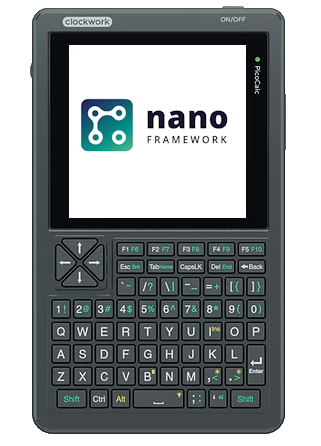
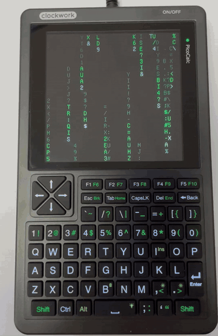

# PicoCalc drivers for .NET nanoFramework

C# drivers for the Clockwork **PicoCalc** (Raspberry Pi Pico or Pico 2 W in the socket) with
[.NET nanoFramework](https://nanoframework.net/). Developed and tested on a Raspberry Pi Pico 2 W (RP2350,
`PICO2_RP2350_W` firmware); also validated on a Raspberry Pi Pico (RP2040, `PICO_RP2040` firmware) with an earlier
firmware: same code on both.

The drivers are published as NuGet packages named `PicoCalcNano.*` ("Nano" stands for nanoFramework). This is a
community project: it is not affiliated with, or endorsed by, Clockwork.

## Drivers

| NuGet package | Version | What it does | Documentation | Status |
|---|---|---|---|---|
| `PicoCalcNano.Keyboard` | 0.1.0 | Keyboard (key events with code, character and modifiers) | [docs/keyboard.md](docs/keyboard.md) | Done |
| `PicoCalcNano.Display` | 0.2.0 | 320x320 display: text screen, drawing, canvas, font | [docs/display.md](docs/display.md) | Done |
| `PicoCalcNano.Console` | 0.2.0 | Console / REPL building block | [docs/console.md](docs/console.md) | Done. Needs Display 0.2 + Keyboard |
| `PicoCalcNano.SdCard` | 0.1.0 | SD card over SPI, FAT16/FAT32 read and write | [docs/sd.md](docs/sd.md) | Done. Writes are slow (optimisation planned) |
| `PicoCalcNano.Sound` | 0.2.0 | Beeps, notes, melodies and sound effects on the two speakers | [docs/sound.md](docs/sound.md) | Done. Needs CLR 1.18.0.96 or later, see Firmware |

The packages are versioned independently; the repository release tag (`v0.2.0`) is the highest package version. See
[CHANGELOG.md](CHANGELOG.md). A demo project that uses them is in the `samples` folder.

## Install

In Visual Studio, open **Manage NuGet Packages** on your nanoFramework project, search for `PicoCalcNano` and
install the drivers you need, or use the Package Manager Console:

```
Install-Package PicoCalcNano.Keyboard
Install-Package PicoCalcNano.Display
```

NuGet also installs the nanoFramework packages that each driver depends on.

## Dependencies

| Driver | nanoFramework NuGet packages |
|---|---|
| Keyboard | `System.Device.I2c` |
| Display | `System.Device.Gpio`, `System.Device.Spi` |
| Console | those of Keyboard and Display, plus `System.Collections` (Queue) |
| SD card | `System.Device.Gpio`, `System.Device.Spi` |
| Sound | `System.Device.Pwm` |

(Names are `nanoFramework.System.Device.*`.) The drivers are independent, except the console that uses the keyboard
and the display. Each one can be packaged and used alone, which saves memory on the Pico.

**One owner per pin.** `PicoCalcConsole` creates and owns its own display and keyboard. Do not create a
`PicoCalcDisplay` or a `PicoCalcKeyboard` yourself in a program that uses the console (use `console.Display` to draw):
the display pins (GP13 to GP15) would already be open and the program would fail with an `InvalidOperationException`
at startup. When you use the drivers separately, call `Dispose()` on one before creating another that uses the same
pins.

## Pins and buses at a glance

| Part | Pins | nanoFramework id |
|---|---|---|
| Keyboard (STM32, I2C address 0x1F) | SDA GP6, SCL GP7 | I2C bus 1 or 2 depending on the firmware (detected by the driver) |
| Display | SCK GP10, MOSI GP11, CS GP13, DC GP14, RST GP15 | SPI bus **2** |
| SD card | MISO GP16, CS GP17, SCK GP18, MOSI GP19 | SPI bus **1** |
| Sound | GP26 left, GP27 right | PWM |

`SpiDevice.Create` ids are **1-based** on RP2040/RP2350 (1 = SPI0, 2 = SPI1) while `SpiDevice.GetBusInfo` is
0-based: this was reported to the nanoFramework team.

## Firmware

Recommended firmware: **CLR 1.18.0.96 or later** (nanoFramework `PICO2_RP2350_W`, build of 16 November 2026). It
contains the two nf-interpreter fixes these drivers benefit from. All the drivers were tested on it with a Pico 2 W
in the PicoCalc. The Pico (RP2040) was not retested with this firmware release.

- **Sound**: needs a firmware that contains pull request #3623 (PWM clock divider on the Pico targets), that is CLR
  1.18.0.96 or later. With an older firmware the pitch does not follow the requested frequency.
- **Keyboard**: the I2C buses of the Pico targets are numbered differently since pull request #3620 (the keyboard
  is bus id 2 instead of 1). The driver detects the right bus by itself, so it works with both numberings.
- **Display and SD card**: SPI bus ids are unchanged (display 2, SD card 1) and work on older and newer firmware.
- **SD card**: the driver is written in C# and does not rely on the firmware's own file system support. The native
  `SDCard` class of `nanoFramework.System.IO.FileSystem` is not implemented yet on the Pico targets (`SDCard`
  throws `NotImplementedException` from `InitNative`, tested on CLR 1.18.0.96).

## Minimal use

```csharp
using PicoCalcNano;

var console = new PicoCalcConsole();     // display + keyboard
console.Start();
console.WriteLine("Hello PicoCalc");
string line = console.ReadLine("> ");    // null if Break (Shift+Esc) or Ctrl+C was pressed
console.WriteLine("You typed: " + line);
```

The SD card and the sound are used on their own, see their docs.



## General tips

1. Add a `Thread.Sleep(3000)` at the start of `Main`: it gives the debugger time to take over.
2. Stop the debugger before deploying. If deployment hangs at the erase step, unplug and replug the USB cable.
3. Do not install batteries while the Pico is powered over USB (back-feeding risk).
4. nanoFramework strings are UTF-8 internally: indexing and `Length` are O(n). Use `ToCharArray()` for large texts.
5. The PicoCalc backlight is controlled by the keyboard MCU: `Alt + ,` and `Alt + .` change the brightness.
6. A pin, a bus or a device can only be opened once. If you get an `InvalidOperationException` when a driver starts,
   check that nothing else in your program (or an earlier object that was not disposed) uses the same pins.

## Licenses

The code is licensed under the Apache License 2.0 (`LICENSE`). The glyph table in `PicoCalcFont.cs` is derived from
GNU Unifont and is used under the SIL Open Font License 1.1: see `NOTICE.md`. Keep that notice and the header of
`PicoCalcFont.cs` if you redistribute the table.
